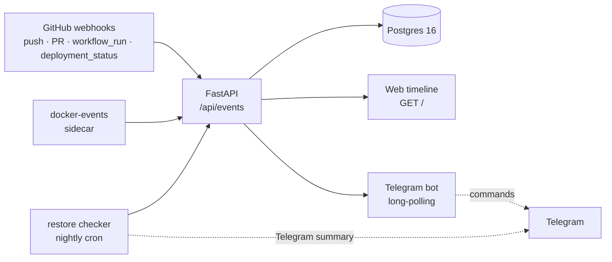

# Incident Copilot

A small self-hosted tool that answers the two questions teams panic about:
**what changed?** and **can we trust our backups?**

Collectors pull events (GitHub commits/PRs, CI deploys, container restarts) into one
Postgres database. A timeline shows everything in order with an "around the alert
time" filter. A nightly restore job proves the backups actually restore. A Telegram
bot answers "what changed in the last 2 hours?" in plain language.

## Architecture



## Quickstart — one command

```bash
cp .env.example .env   # fill in GITHUB_WEBHOOK_SECRET (long random string)
docker compose up      # db + api
```

Then open the timeline: **http://localhost:8000/** — and query the API:

```bash
curl "localhost:8000/api/events?since=$(date -u -d '2 hours ago' +%FT%TZ)"
```

Add the extras with profiles:

```bash
docker compose --profile bot up          # Telegram bot (needs TELEGRAM_BOT_TOKEN in .env)
docker compose --profile collectors up   # docker-events sidecar (needs /var/run/docker.sock)
```

Local dev without Docker (API only):

```bash
docker compose up -d db
pip install -r requirements.txt
uvicorn app.main:app --reload --port 8000
```

## Telegram bot

`python -m bot.main` (stdlib only — no new dependencies). Needs `TELEGRAM_BOT_TOKEN`
(create one with **@BotFather**); talks to the API at `COPILOT_API_URL`
(default `http://localhost:8000`).

| Command | What it answers |
|---------|-----------------|
| `/start`, `/help` | Intro and command list |
| `/changes [hours]` | "What changed in the last N hours?" (default 2) — newest events first, max 10 per reply |
| `/restore` | "Did last night's backup restore OK?" — the latest `restore_check` result |
| `/alerts` | Latest failures, deploys and container events |

You can also write naturally — the bot matches plain phrases:

- "what changed in the last 5 hours?" → `/changes 5`
- "did the backup restore ok?" → `/restore`
- "any alerts?" → `/alerts`

Anything else gets a `/help` hint. Times are shown in UTC. Replies cap at 10
events with a pointer to the web timeline for the rest. AI summarization is a
documented future step — today you get the raw facts, fast.

## Receiving GitHub webhooks locally

GitHub can't reach `localhost`, so tunnel it with [smee.io](https://smee.io):

```bash
# new channel at https://smee.io -> copy the URL, then:
npx smee-client --url https://smee.io/<your-channel> --target http://localhost:8000/webhooks/github
```

In your repo: **Settings → Webhooks → Add webhook**
- Payload URL: `https://smee.io/<your-channel>`
- Content type: `application/json`
- Secret: the same value as `GITHUB_WEBHOOK_SECRET`
- Events: "Send me everything" (handles `push`, `pull_request`, `workflow_run`,
  `deployment_status`; others are acknowledged and ignored)

## Web timeline

`GET /` — plain HTML + vanilla JS over the same JSON API:

- **Filters:** since/until pickers, source / type / repo dropdowns (populated from the data), quick chips for **last 1h / 6h / 24h**
- **Around alert time:** enter the alert timestamp and a ± window (15/30/60 min) to see exactly what changed around the incident
- Events are color-coded: red for failures/OOM/exits, amber for warnings, green for successes

## Docker events collector

A small stdlib-only poller that tails `docker events` and posts container deaths,
OOM-kills, destroys and image pulls to the API:

```bash
COPILOT_API_URL=http://localhost:8000 python -m collectors.docker_events
```

- Exits non-zero with a clear message when no Docker daemon is reachable — it never
  affects the API process
- In compose: `--profile collectors` mounts the socket read-only

## Restore checker

Proves your backups actually restore. Spins up an **ephemeral** Postgres container,
restores the backup into it, runs sanity checks, then deletes the container —
even when something fails.

```bash
# From a backup file (pg_dump custom .dump or plain .sql)
python -m restore.check --backup-file /backups/latest.dump --checks restore/checks.example.yaml

# Or dump a live source first, then restore the fresh dump
python -m restore.check --source-url "postgresql://user:pw@host/db" --checks checks.yaml
```

What it does, in order:

1. Verifies a Docker daemon is reachable (clear error + exit 2 if not)
2. Takes the backup (file, or `pg_dump -Fc` of `--source-url`; the URL password never hits logs)
3. Starts `postgres:16.4` with a random password on a random localhost port
4. Waits for `pg_isready`, restores via `pg_restore` / `psql`
5. Runs the checks file: per-table **minimum row counts** + custom SQL queries that must return ≥ 1 row
6. POSTs a result event (`source="restore"`, `type="restore_check"`) to the API — ask the bot "did last night's backup restore OK?"
7. Sends a Telegram summary if `TELEGRAM_BOT_TOKEN` + `TELEGRAM_CHAT_ID` are set (otherwise logs "skipping"); Telegram failures never fail the check
8. `docker rm -f` the container in a `finally` block — no orphans

Exit codes: `0` all checks passed · `1` restore or a check failed · `2` infra/usage error.

### The checks file

Copy `restore/checks.example.yaml` → `checks.yaml` and tune the minimums:

```yaml
tables:
  users: 1000      # fail if the restored users table has fewer rows
  orders: 1
queries:
  - name: "recent orders exist"
    sql: "SELECT 1 FROM orders WHERE created_at > now() - interval '7 days' LIMIT 1"
```

JSON works too (use a `.json` suffix). A check that errors (e.g. missing table)
is recorded as failed with the error in `detail` — it doesn't abort the rest.

### Nightly schedule

See `restore/cron.example` — a cron line for 03:00 daily. Per run the footprint is
one throwaway container (~100–200 MB RAM while restoring) plus the dump in a temp
dir. Host needs: `docker`, `postgresql-client` (`pg_dump`/`pg_restore`/`psql`).

### Telegram setup (2 minutes)

1. Message **@BotFather** on Telegram → `/newbot` → copy the token → `TELEGRAM_BOT_TOKEN`
2. Message **@userinfobot** → copy your id → `TELEGRAM_CHAT_ID` (a group/channel id works too — add the bot to it)
3. Export both where the checker runs (cron env, systemd `Environment=`, or `.env` — never commit them)

## Roadmap

| Week | Status | Scope |
|------|--------|-------|
| 1 | ✅ done | GitHub webhook collector, `events` table, timeline API (`GET /api/events`), generic ingest (`POST /api/events`), health check |
| 2 | ✅ done | CI webhook events (`workflow_run`, `deployment_status`), Docker events collector, web timeline UI with time + around-alert filters |
| 3 | ✅ done | Nightly restore job: ephemeral-container restore, checks file, result event, Telegram summary |
| 4 | ✅ done | Telegram bot chat commands, app Dockerfile, one-command `docker-compose up` |

## API reference

| Method | Path | Description |
|--------|------|-------------|
| `POST` | `/webhooks/github` | GitHub webhook receiver. Requires `X-Hub-Signature-256` HMAC-SHA256 (401/403 on missing/invalid). Handles `ping` → `pong`. Dedupes redeliveries via `X-GitHub-Delivery`. |
| `GET` | `/api/events` | Timeline. Filters: `since`, `until` (ISO datetimes), `source`, `type`, `repo`. Pagination: `limit` (1–500, default 50), `offset`. Newest first. |
| `POST` | `/api/events` | Generic ingest for collectors. Body: `source*`, `type*`, `occurred_at`, `actor`, `repo`, `title`, `url`, `payload`. |
| `GET` | `/health` | Liveness + DB connectivity (`SELECT 1`). |
| `GET` | `/` | Web timeline UI (static page). |

Bot query cheat-sheet (what the commands ask under the hood):

```bash
# /changes 2
curl "localhost:8000/api/events?since=$(date -u -d '2 hours ago' +%FT%TZ)"
# /restore
curl "localhost:8000/api/events?source=restore&type=restore_check&limit=1"
# /alerts (bot filters client-side to failure-prone types)
curl "localhost:8000/api/events?limit=50"
```

## Security notes

- Webhook signatures are verified with `hmac.compare_digest` (constant time). The endpoint **fails closed**: no `GITHUB_WEBHOOK_SECRET` configured → 500, nothing accepted.
- Redeliveries are deduped on the unique `X-GitHub-Delivery` id — GitHub retries can't double-count a deploy.
- Raw payloads are stored as JSONB for forensics; never log the webhook secret.
- The bot only *reads* the API and only *replies* to messages — it can't change anything.
- `.env` is gitignored — only `.env.example` is committed.

## Demo

> 🎬 **Demo GIF — recorded by the maintainer.** Needs a running stack
> (`docker compose --profile bot up`), a real Telegram bot token, and one
> restore-check run. Not faked: the placeholder below is replaced with the real
> recording.
>
> `docs/demo.gif` ← coming soon

Planned shots: (1) push a commit → webhook event appears on the timeline;
(2) "around alert time" filter isolating a deploy; (3) Telegram: "what changed
in the last 2 hours?"; (4) nightly restore check → ✅ summary in Telegram.

## Tests

```bash
pip install -r requirements-dev.txt
pytest -v   # runs on in-memory SQLite; prod target is Postgres 16
```
